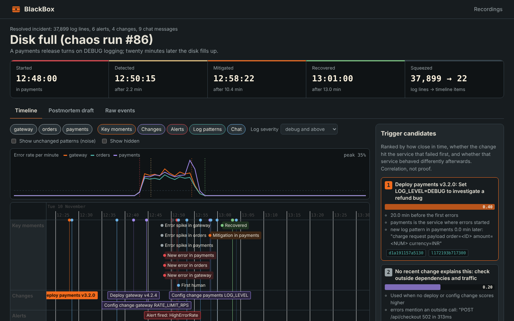
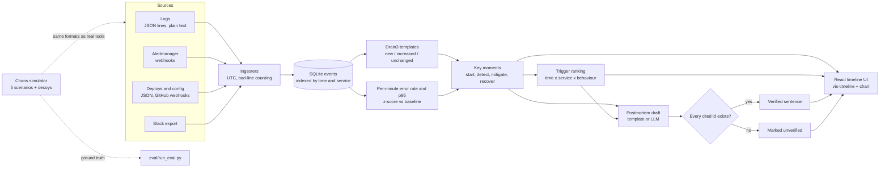

# BlackBox

**When a website or app breaks, BlackBox collects the logs, alerts, deploys and team chat, turns 34,000 log lines into about 20 key moments, ranks the changes that might have caused it, and drafts a postmortem where every sentence links to its evidence.**

After an outage, engineers spend hours scrolling logs, dashboards and Slack to answer "what happened, and in what order?" Then someone writes the postmortem from memory. BlackBox does the first pass in about two seconds, and it shows its working: every claim points to the events behind it, and trigger candidates are labelled as correlations, not proof.



## What it does

- **Ingests four sources** into one UTC event format: JSON or plain-text logs (file upload or HTTP), Alertmanager webhooks (firing and resolved), deploys and config changes (a simple JSON format or GitHub `deployment_status` / `push` webhooks), and Slack export folders. Bad lines are skipped and counted, never crash the import.
- **Removes noise** with Drain log-template mining: lines with the same shape collapse into one pattern with a count, first and last time, and a label (new, increased, decreased, unchanged) against a baseline window before the incident.
- **Finds key moments** with plain statistics: first occurrence of each new error pattern, error-rate and p95-latency spikes per service (z-score against the baseline), alerts, deploys, the first human message, mitigation, and recovery (every service back near baseline for three minutes).
- **Times the incident**: start, detection, mitigation and recovery, plus time-to-detect, time-to-mitigate and time-to-recover.
- **Ranks trigger candidates** by time closeness, whether the change hit the service that failed first, and whether that service behaved differently right after the change. An "outside cause" candidate is always in the list, so when nothing internal changed, it wins.
- **Interactive timeline**: one lane per source plus key moments, an error-rate chart synced to the zoom, filters by service, lane and severity, a noise toggle, and an inspector to pin, hide and annotate events.
- **Evidence-linked postmortem**: summary, impact, timeline, trigger candidates, what went well, what went badly, and follow-ups. Each sentence carries event ids that are checked to exist; anything without valid evidence is marked "unverified". Wording is blameless (people's names from chat are replaced). Export to Markdown.
- **A chaos lab**: a simulated shop (gateway, orders, payments) where five kinds of incident are injected for real, with ground truth recorded, so the demo and the evaluation use incidents with known answers.

## Results

50 injected incidents (5 scenarios x 10 runs), each with two decoy changes placed at random times on random services, sometimes on the very service that fails:

| Metric | Result |
|---|---|
| True trigger ranked first | **49 of 50** (98%); held-out runs only: 29 of 30 |
| True trigger in top 3 | 50 of 50 |
| First failing service identified | 50 of 50 |
| Mean error in start / recovery time | 0.24 min / 0.50 min |
| Noise reduction | **34,033 log lines -> 23 timeline items** (mean) |
| Postmortem sentences with valid evidence | 100% |

Per-scenario tables, the one failure case (a decoy deploy to the same service 40 seconds before the real config change), and honest notes on what these numbers do and do not show: [`eval/results.md`](eval/results.md).

## How it works



| Part | Tool |
|---|---|
| Backend | Python, FastAPI, Pydantic |
| Storage | SQLite (WAL), timestamps as UTC epoch with indexes on time, service and source |
| Log template mining | Drain3 with masks for ids, numbers, hex, IPs |
| Anomaly detection | Per-minute rates and z-scores (no ML model to train) |
| Postmortem | Evidence-linked template; optional OpenAI-compatible LLM (OpenRouter free models) with strict JSON |
| Frontend | React 19, Vite, vis-timeline, hand-drawn SVG chart |
| Demo system | Deterministic simulator of gateway, orders, payments and a database pool |

## Quick start (Windows, VS Code)

You only need **Python 3.10+**. The React app is already built and served by FastAPI.

1. Extract the folder and open it in VS Code.
2. Double-click `run.bat` (or run `.\run.bat` in the VS Code terminal).
3. Your browser opens at http://127.0.0.1:8001. Pick a scenario and press **Inject the fault and record**.

`run.bat` creates a virtual environment, installs the requirements and starts the server. It does not use `Activate.ps1`, so PowerShell's execution policy is not a problem. BlackBox uses port 8001, so it can run next to TermGuard (8000).

**Manual steps** (any OS):

```bash
python -m venv .venv
.venv\Scripts\python -m pip install -r backend\requirements.txt      # macOS/Linux: .venv/bin/python
.venv\Scripts\python -m uvicorn app.main:app --app-dir backend --port 8001
```

**Run an incident from the command line**

```bash
python demo/simulate.py --scenario disk_full --seed 7      # writes demo/output/disk_full-7/
```

Then zip that folder and import it on the home page, or use the API below.

**Optional**

- *LLM postmortem*: copy `.env.example` to `.env` and set `LLM_API_KEY`. Only key moments and pinned events are sent, never raw logs. Ids are still verified.
- *Edit the UI*: `cd frontend && npm install && npm run dev` (Node 20+), then open http://localhost:5174. Run `npm run build` to update the bundled version.
- *Docker*: `docker compose up --build`.

**Tests and evaluation**

```bash
python -m pytest backend/tests -q     # 23 tests: time zones, out-of-order events, 4 ingesters, Drain, analysis, postmortem, API
python eval/run_eval.py               # 50 chaos incidents, writes eval/results.md (about 2 minutes)
```

## Connecting real tools

| Source | How |
|---|---|
| Prometheus Alertmanager | Add a webhook receiver pointing to `POST /api/ingest/alerts`. A firing alert opens an incident if none is open. |
| GitHub | Add a webhook for `deployment_status` and `push` events to `POST /api/ingest/deploys` (BlackBox reads the `X-GitHub-Event` header). |
| Any log shipper | `POST /api/ingest/logs` with JSON lines or plain text in the body, or upload a file. |
| Slack | Export the incident channel and upload the zip to `POST /api/ingest/chat`. |

Interactive API docs: http://127.0.0.1:8001/docs

## Project layout

```
backend/app/        models, timeutil, store, ingest/ (logs, alerts, deploys, chat), importer,
                    patterns (Drain), metrics, correlate, pipeline, postmortem, llm, main
backend/tests/      pytest suite with fixtures for every source
demo/simulate.py    chaos simulator and ground truth
eval/run_eval.py    evaluation harness -> eval/results.md
frontend/           React + Vite + vis-timeline (dist/ is committed, so Node is optional)
docs/               screenshots, demo script, interview prep
```

## Limitations

- The demo incidents are simulated. Real systems add clock skew between hosts, sampled or missing logs, retries that hide errors, and several changes landing at once.
- Spike detection works at one-minute resolution and needs a quiet baseline before the incident. An incident that starts at the very beginning of the data has no baseline.
- Trigger ranking only knows about changes that were ingested. A change made by hand on a server, with no deploy event, can only show up as the "outside cause" candidate.
- The service dependency graph is a setting (`SERVICE_DEPENDENCIES`), not discovered from traces.
- SQLite and in-process Drain are fine for one incident of up to a few hundred thousand lines. For millions of lines per minute you would stream into a column store (ClickHouse, DuckDB), mine templates per shard, and pre-aggregate per-minute metrics.

---

Built by [Siddharth Bhat](https://github.com/SiddharthBhat120).
